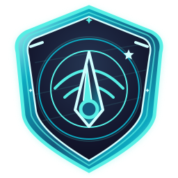
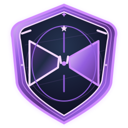
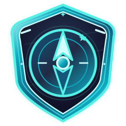
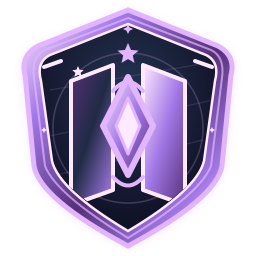
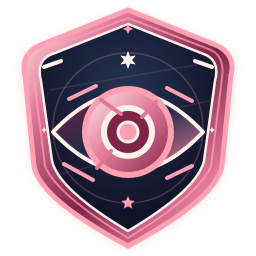
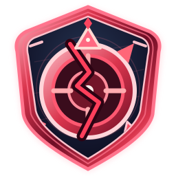

# 25개 배지 일러스트 시안

기존 Unicode 심볼이 아니라 **업적 칭호가 환기하는 사물·장면**을 기반으로 만든 개별 SVG 이미지이다. 게임의 검은 배경에 어울리도록 홀로그램 에나멜 휘장으로 디자인했다.

| | | | |
|:---:|:---:|:---:|:---:|
|  |  |  |  |
| **신입 에이전트** | **뉴스 유목민** | **단골 관측자** | **연승의 신호탄** |
|  |  |  |  |
| **흐름을 타는 자** | **무패의 궤도** | **소수점 견습생** | **근접 조우** |
|  |  |  |  |
| **예민한 촉** | **엇나간 소수점** | **한 끗의 운명** | **소수점의 지배자** |
|  |  |  |  |
| **방향 감각** | **양방향 레이더** | **양면의 승부사** | **끊기지 않는 박자** |
|  |  |  |  |
| **구간 포착자** | **경계의 지배자** | **기사 감별사** | **특종의 눈** |

## 화면 적용
- **Common**: 실버 메탈 테두리
- **Rare**: 청록색 코어와 발광 테두리
- **Epic**: 보라색 수정 메탈 테두리
- **Legendary**: 각 배지의 고유 색상과 기존 닉네임 후광 유지
- 미획득: 컬렉션에서 동일 그림을 어두운 회색으로 처리
- 장착: 메인·랭킹 닉네임 옆에 축소된 이미지 표시

각 아이콘은 `assets/badges/<배지ID>.svg`의 256×256 벡터 이미지다. 향후 디자인 변경 시 같은 파일명만 교체하면 업적 ID·등급·구글 시트 데이터를 수정할 필요가 없다.
## 추가 배지 5개

| | | | | |
|:---:|:---:|:---:|:---:|:---:|
|  |  |  |  |  |
| 전설의 정복자 | 파산 선고 | 금리의 생존자 | 첫 신용 | 첫 상환 |

MYTHIC은 Legendary보다 상위 등급으로, 황금색 ‘전설의 정복자’와 적색 ‘파산 선고’가 각기 다른 효과를 갖는다.

## Legendary 날개 디자인 (2026-11)

기존 에나멜 방패에 **미러링된 좌우 금속 날개**를 추가했다. 
최상위 Mythic과 구별되는 Legendary 고유의 위엄을 강화하되, 
기존 중심 도안(천체 궤도·소수점 왕관·경계 수정·특종의 눈·금리 모래시계)과 배지 ID는 유지한다.

| 무패의 궤도 | 소수점의 지배자 | 경계의 지배자 | 특종의 눈 | 금리의 생존자 |
|:---:|:---:|:---:|:---:|:---:|
|  |  |  |  |  |
| 천체 금빛 날개 | 냉광 정밀 날개 | 보랏빛 수정 날개 | 붉은 감시 날개 | 샴페인빛 생존 날개 |

모든 날개는 SVG 내부에 포함된 벡터이다. 추가 HTTP 요청·이미지 의존성은 없다.
모바일 컬렉션에서 기존 256×256 SVG 파일을 그대로 렌더링하므로 스크롤 영역과
배지 장착/소유 판정, 은행 로직에 변경이 없다. 미획득 상태의 회색 처리도 유지한다.
